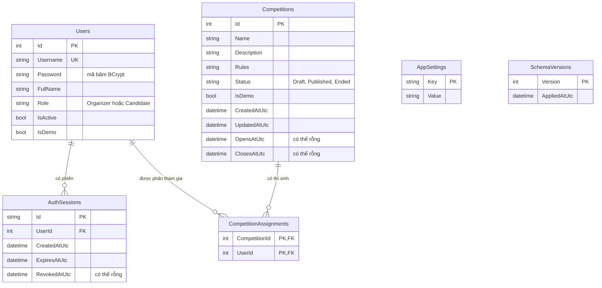

# Nền tảng và quy tắc mở rộng

## Phạm vi hiện tại

Giữ frontend React/Vite và backend ASP.NET Core 8/Entity Framework Core/SQLite trong cùng dự án. Bước 1 cung cấp đăng nhập, phiên, vai trò, hồ sơ, quản lý thông tin tài khoản và cấu hình múi giờ. Bước 2 bổ sung Cuộc thi. Bước 3 bổ sung [Đề thi, ngân hàng câu hỏi, Excel, phiên bản và Lịch thi](exams-and-schedules.md). Bước 5 bổ sung hướng dẫn, làm và nộp bài theo lượt đã được máy chủ phát. Bước 6 bổ sung chấm điểm theo snapshot, xếp hạng và xuất Excel.

## Hợp đồng API

| API | Quyền | Kết quả |
| --- | --- | --- |
| `GET /api/health` | Công khai | Trạng thái máy chủ |
| `GET /api/system/public` | Công khai | Tên ứng dụng, giờ máy chủ UTC, múi giờ, trạng thái chế độ minh họa |
| `POST /api/Auth/login` | Công khai | Kiểm tra tài khoản/mật khẩu, cấp JWT gắn phiên |
| `GET /api/Auth/me` | Đã đăng nhập | Hồ sơ tài khoản hiện tại |
| `POST /api/Auth/logout` | Đã đăng nhập | Thu hồi phiên hiện tại |
| `GET /api/organizer/overview` | `Organizer` | Tổng quan từ dữ liệu tài khoản thực lưu trong SQLite |
| `GET /api/organizer/users` | `Organizer` | Danh sách tài khoản không có mật khẩu/mã băm |
| `GET /api/organizer/users/{id}` | `Organizer` | Thông tin một tài khoản không có thông tin xác thực |
| `POST /api/organizer/users` | `Organizer` | Tạo thí sinh với mật khẩu tạm `123456`, bắt buộc đổi mật khẩu khi đăng nhập |
| `PUT /api/organizer/users/{id}` | `Organizer` | Cập nhật họ tên, đơn vị và trạng thái |
| `DELETE /api/organizer/users/{id}` | `Organizer` | Xóa thí sinh chỉ khi chưa có phân công/lượt thi; nếu có thì khóa |
| `GET /api/candidate/overview` | `Candidate` | Không gian Thí sinh và thông tin múi giờ |
| `GET /api/organizer/competitions` | `Organizer` | Danh sách tất cả Cuộc thi |
| `GET /api/organizer/competitions/{id}` | `Organizer` | Chi tiết Cuộc thi để chỉnh sửa |
| `POST /api/organizer/competitions` | `Organizer` | Tạo Cuộc thi Nháp từ tên, mô tả, thể lệ |
| `PUT /api/organizer/competitions/{id}` | `Organizer` | Chỉ sửa tên, mô tả, thể lệ |
| `GET /api/candidate/competitions` | `Candidate` | Chỉ Cuộc thi Published có phân cho tài khoản hiện tại |
| `GET /api/candidate/competitions/{id}` | `Candidate` | Cùng điều kiện với danh sách; không đủ điều kiện trả 404 |
| `GET /api/candidate/competitions/{id}/attempt` | `Candidate` | Trạng thái lượt hiện tại; câu hỏi chỉ gửi khi lượt đang làm |
| `POST /api/candidate/competitions/{id}/attempt/start` | `Candidate` | Bắt đầu lượt hợp lệ hoặc khôi phục lượt chưa nộp |
| `PUT /api/candidate/competitions/{id}/attempt/questions/{questionId}` | `Candidate` | Lưu phương án và cờ xem lại cho câu thuộc lượt hiện tại |
| `POST /api/candidate/competitions/{id}/attempt/submit` | `Candidate` | Chốt bài một lần, trả trạng thái và thời điểm nộp |
| `POST /api/candidate/competitions/{id}/attempt/lease` | `Candidate` | Gia hạn quyền ghi cho tab đang làm bài |
| `POST /api/organizer/competitions/{id}/assignments/{userId}/attempt-session` | `Organizer` | Chuyển phiên hoặc vô hiệu hóa lượt cũ và cấp quyền thi lại có audit |
| `GET /api/organizer/competitions/{id}/results` | `Organizer` | Chấm snapshot đề đã phát, trả kết quả và thứ hạng theo nhóm |
| `GET /api/organizer/competitions/{id}/results/excel` | `Organizer` | Xuất workbook cùng tập kết quả, có thể lọc `rankingGroupName` |

Tên đăng nhập được chuẩn hóa khoảng trắng đầu/cuối và chữ hoa/chữ thường khi đăng nhập. Hồ sơ có `username`, `fullName`, `role`, `isDemo`, `expiresAt`; đăng nhập bổ sung `token`. Không chấp nhận trường vai trò từ giao diện để cấp quyền.

API không tìm thấy trả `404`; không dùng trang HTML dự phòng để che lỗi API. Đường dẫn màn hình web được phục vụ bằng ứng dụng React.

Tài khoản thí sinh mới được băm mật khẩu ở máy chủ và đánh dấu bắt buộc đổi mật khẩu. Tài khoản có phân công hoặc lượt thi không xóa cứng để bảo toàn lịch sử; Ban Tổ chức có thể khóa tài khoản.

Đầu vào tạo/sửa Cuộc thi chỉ gồm `name`, `description`, `rules`; không cho phía trình duyệt tự đặt trạng thái, lịch, người tạo, thời điểm hoặc cờ minh họa. Máy chủ đặt `Draft` khi tạo và giữ các trường này khi sửa. Hồ sơ Cuộc thi gồm `id`, `name`, `description`, `rules`, `status`, `isDemo`, `createdAtUtc`, `updatedAtUtc`, `opensAtUtc`, `startDeadlineUtc`, `closesAtUtc`. API lịch riêng kiểm tra ba mốc trước khi lưu. API Thí sinh bổ sung `canStart` và `startBlockedReason`; API bắt đầu vẫn kiểm tra lại lịch, trạng thái công bố, người dùng và phân công trước khi tạo lượt.

## Nguồn quyết định quyền

JWT xác minh phiên. SQLite quyết định tài khoản còn hoạt động và vai trò hiện tại. Mỗi API quản trị hoặc dự thi bổ sung sau này phải có policy phía máy chủ; điều kiện ở React chỉ giúp điều hướng. Thiết lập mặc định yêu cầu xác thực để tránh API mới vô tình công khai; chỉ endpoint được đánh dấu công khai mới bỏ qua xác thực.

Mọi API lượt thi ngoài vai trò `Candidate` kiểm tra cuộc thi đã công bố, tài khoản hiện tại có phân đề hợp lệ trong cuộc thi và attempt thuộc đúng tài khoản/đề/phiên bản đã giao. Unique index SQLite bảo đảm chỉ một attempt chưa vô hiệu hóa cho mỗi tài khoản/cuộc thi; xung đột bắt đầu cùng lúc trả về attempt thắng cuộc thay vì tạo bản sao. Mỗi lượt gắn với phiên đăng nhập và ID tab; API lưu/submit kiểm tra quyền ghi, tab có heartbeat lease 30 giây. Ban Tổ chức có thể chuyển phiên sang phiên đăng nhập mới nhất còn hiệu lực; thi lại ghi lý do và vô hiệu hóa lượt trước trước khi cấp quyền tạo lượt thay thế. Máy chủ dùng đồng hồ UTC; giờ kết thúc là sớm hơn giữa thời lượng của phiên bản đề đã ghim và giờ đóng cuộc thi. Không dùng đồng hồ hay dữ liệu trả lời của trình duyệt làm quyết định cuối cùng.

Khi phát đề, máy chủ xáo trộn câu hỏi/phương án đúng một lần và lưu vị trí vào `ExamAttemptQuestions`. Cùng bảng lưu câu trả lời, cờ xem lại và thời điểm cập nhật để reload khôi phục đúng thứ tự/đáp án. Hạn nộp bất biến; hosted service và API cùng tự chốt ở chính mốc hạn khi trình duyệt đóng. Submit lặp trả kết quả và thời điểm đã lưu. Response thí sinh chỉ có ID/vị trí/loại/nội dung/phương án cùng câu trả lời của chính họ; không gửi đáp án đúng, điểm, giải thích, nguồn hoặc snapshot. Lượt đã nộp chỉ trả trạng thái/thời điểm; lịch công bố điểm/đáp án chưa được cấu hình.

Ban Tổ chức chấm lượt đã nộp bằng `SnapshotJson` đã ghim, so sánh khóa đáp án lưu với đáp án đúng và cộng `Points` theo `Group`. Cờ `IsScenario` cũng nằm trong snapshot, vì vậy sửa câu hỏi nháp không đổi kết quả đã phát. Lượt `IsInvalidated` được hiển thị là không hợp lệ nhưng không tham gia xếp hạng. `ExamFieldGroups.RankingGroupName` xác định nhóm đề được xếp chung; thứ hạng ưu tiên số câu đúng giảm dần, rồi thời gian làm bài từ `StartedAtUtc` đến `SubmittedAtUtc` tăng dần; nếu cả hai tiêu chí bằng nhau thì đồng hạng. Điểm thành phần được giữ để đối chiếu nhưng không quyết định thứ hạng. API Excel dùng cùng dịch vụ/danh sách kết quả với bảng trên giao diện.

## Dữ liệu, nâng cấp và múi giờ

Nâng cấp schema phải cộng dồn, giữ tài khoản/mật khẩu/cấu hình hiện có và chạy lại an toàn. Mọi dữ liệu minh họa có cờ riêng; chỉ seed khi bật cấu hình minh họa tường minh. Không đếm số giả hoặc tạo lịch thi giả trên dashboard.

Nâng cấp schema phiên bản 2 thêm `Competitions` và `CompetitionAssignments`, không tạo sẵn cuộc thi mẫu. Trạng thái bị giới hạn ở ba giá trị đã định; cặp `(CompetitionId, UserId)` là duy nhất. Các bước công bố, phân thí sinh và cấu hình lịch sẽ dùng lại hai bảng này.

Quyền xem của Thí sinh: `Status == Published AND UserId == tài khoản hiện tại trong CompetitionAssignments`. Điều kiện giờ không che thông tin cuộc thi đã được phân; chỉ quyết định `canStart`. Cần đủ ba mốc và `OpensAtUtc <= UtcNow <= StartDeadlineUtc`, đồng thời `UtcNow < ClosesAtUtc`. Chi tiết schema v3 và phiên bản đề trong [tài liệu Đề thi/Lịch thi](exams-and-schedules.md).

Múi giờ định danh IANA `Asia/Ho_Chi_Minh` được lưu ở cấu hình ứng dụng. Thời điểm phiên và thời điểm nghiệp vụ lưu UTC; hiển thị dùng `Intl.DateTimeFormat` với `timeZone` tường minh. Khi thêm biểu mẫu lịch, chuyển thời gian Việt Nam sang UTC ở máy chủ trước khi lưu và kiểm tra, không dùng múi giờ hệ điều hành của người dùng.

## Tài liệu kỹ thuật đối chiếu

- [Microsoft: xác thực JWT cho ASP.NET Core](https://learn.microsoft.com/en-us/aspnet/core/security/authentication/configure-jwt-bearer-authentication?view=aspnetcore-8.0)
- [Microsoft: phân quyền theo vai trò](https://learn.microsoft.com/en-us/aspnet/core/security/authorization/roles?view=aspnetcore-8.0)
- [Microsoft: sự kiện OnTokenValidated](https://learn.microsoft.com/en-us/dotnet/api/microsoft.aspnetcore.authentication.jwtbearer.jwtbearerevents.ontokenvalidated)
